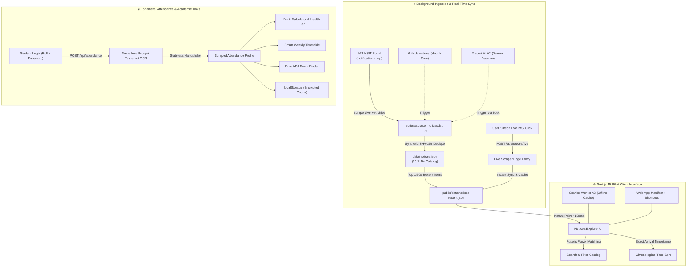

<div align="center">

# 🏛️ IMS NSUT Modern Portal & Ingestion Engine

### *Next-Gen Academic Dashboard, Smart Timetable, 10,000+ Notices Search, and Attendance Bunk Simulator for NSUT Students*

[](https://nextjs.org)
[](https://typescriptlang.org)
[](https://tailwindcss.com)
[](https://web.dev/progressive-web-apps/)
[](https://github.com/naptha/tesseract.js)
[](.github/workflows/sync_notices.yml)
[](LICENSE)

<p align="center">
  <b>A unified, high-performance academic companion & background scraper for Netaji Subhas University of Technology (NSUT).</b><br>
  Built with sub-10ms fuzzy search over 10,000+ circulars, exact arrival timestamps, real-time What-If bunk margin forecasting, interactive weekly timetables, APJ room vacancy tracking, Stock Android dynamic theming, and zero persistent credential storage.
</p>

</div>

---

## 📑 Table of Contents

- [⚡ Feature Highlights](#-feature-highlights)
- [🔍 In-Depth Feature Breakdown](#-in-depth-feature-breakdown)
  - [1. Notices & Circulars Explorer](#1-notices--circulars-explorer)
  - [2. Attendance & Bunk Margin Intelligence](#2-attendance--bunk-margin-intelligence)
  - [3. Smart Academic Timetable](#3-smart-academic-timetable)
  - [4. Free APJ Room Finder](#4-free-apj-room-finder)
  - [5. Progressive Web App (PWA) & Multi-Display Engine](#5-progressive-web-app-pwa--multi-display-engine)
  - [6. Stock Android Dynamic Theming & OLED Dark Mode](#6-stock-android-dynamic-theming--oled-dark-mode)
  - [7. Zero-Knowledge Privacy & Stateless OCR Engine](#7-zero-knowledge-privacy--stateless-ocr-engine)
- [🏗️ System Architecture](#️-system-architecture)
- [📂 Modular Workspace Layout](#-modular-workspace-layout)
- [🔌 API Specification](#-api-specification)
- [🚀 Quick Start & Development](#-quick-start--development)
- [📱 Outbound Worker (Termux / Xiaomi Mi A2)](#-outbound-worker-termux--xiaomi-mi-a2)
- [📜 Legal & Ethical Notice](#-legal--ethical-notice)
- [🤝 Contributing & License](#-contributing--license)

---

## ⚡ Feature Highlights

| Capability | Description | Technical Performance / Specification |
| :--- | :--- | :--- |
| 🔍 **10,000+ Notices Search** | Instant full-text fuzzy matching across circulars from 2018 to present | **Sub-10ms** client-side search via `Fuse.js` |
| 🕒 **Exact Arrival Timestamps** | Scraper-recorded ISO 8601 timestamps showing down to the minute when circulars arrived | Real-time IST formatting & Chronological Sort |
| 🔄 **On-Demand Live Sync** | Direct real-time scraper trigger connecting to `imsnsit.org` for newly announced orders | Edge scraper proxy (`/api/notices/live`) |
| 📊 **Attendance Bunk Engine** | Calculates safe bunks ($>75\%$) and exact recovery lecture requirements | Mathematical forecast model + What-If simulator |
| 📈 **Course Health Distribution** | Segmented visual analytics bar splitting courses into Safe, Margin, and Shortage | Multi-segment responsive progress track |
| 📅 **Smart Weekly Timetable** | Enrolled courses mapped to Mon–Fri period slots (09:00–17:00) with Live Now indicator | System time synced with APJ venue & faculty tags |
| 🏫 **Free APJ Room Finder** | Real-time classroom vacancy tracker across APJ complex for quiet self-study | Period slot filter & room status mapping |
| 📱 **Full PWA Suite** | 100% installable on Android, iOS, Windows, macOS with home screen shortcuts | `display: standalone`, offline service worker v2 |
| 🎨 **Material You Dynamic Theming** | 6 Stock Android accent palettes (Lime Aurora, Pixel Sky, Neon Lavender, etc.) | Dynamic CSS variables + OLED Dark Mode Pro |
| 🛡️ **Zero-Credential Storage** | Ephemeral, end-to-end TLS session handling. Passwords never touch any database | 100% Client-side sandbox & stateless tokens |
| 🤖 **Serverless OCR Auto-Solver** | Auto-decodes 4-character numeric captcha via Tesseract.js WASM | Automated bypass with manual input fallback |

---

## 🔍 In-Depth Feature Breakdown

### 1. Notices & Circulars Explorer

- **Massive 10,000+ Catalog**: Complete indexed database of all circulars, notifications, examination datesheets, recruitment drives, and hostel notices released on the official IMS NSIT portal.
- **Sub-10ms Fuzzy Search**: Powered by a custom-weighted `Fuse.js` client index searching through titles, publishing departments, and signatory names with zero network latency.
- **Exact Arrival Timestamps**: Every notice captured by our sync pipeline records an ISO 8601 timestamp (`scrapedAt`). Students see badges indicating the precise time a notice arrived on the portal (e.g. `14-11-2026 • 🕒 10:33 AM`).
- **Multi-Criteria Sorting**:
  - `🕒 Arrival Time (Newest)`: Strictly orders notices by their exact arrival timestamp down to the second, honoring the natural newest-first order of the official portal.
  - `📅 Date (Newest First)`: Sorts notices by calendar publication date.
  - `⏳ Date (Oldest First)`: Reverse chronological view for historical archive research.
  - `🔤 Title (A–Z)`: Alphabetical sorting.
- **Faceted Category Filtering**: Instant 1-click filter chips for **Hostels**, **Exams & Datesheets**, **Academics**, **Placements & Internships**, and **Sports & NSS**, combined with an **Academic Year** selector (2018–2026) and an **Attachments Only** toggle.
- **Embedded Document Viewer**:
  - Eliminates ugly raw PHP redirection links.
  - Streams PDFs securely through an internal edge proxy (`/api/document?url=...`).
  - Features fullscreen view (<kbd>Esc</kbd> to toggle), 1-click clean sanitized filename download (`BTech_Datesheet_2026.pdf`), and permanent shareable URLs.

---

### 2. Attendance & Bunk Margin Intelligence

- **Instant 0-Latency Load**: Student attendance data is securely cached in local storage. The dashboard opens with zero spinner wait time on repeat visits.
- **Course Health Analytics Bar**: Inspired by modern performance analytics, this multi-segment visual progress track categorizes all enrolled semester courses into:
  - 🟢 **Safe**: Courses securely above $75\%$ target threshold.
  - 🟡 **Margin Alert**: Courses dangerously close ($75\% \le \text{Attendance} < 78\%$).
  - 🔴 **Shortage Warning**: Courses currently below the mandatory $75\%$ university requirement.
- **Mathematical Bunk & Recovery Formula**:
  - **Safe Bunks Allowed**:
    $$\text{Safe Bunks} = \max\left(0, \left\lfloor \frac{A - 0.75 \times H}{0.75} \right\rfloor\right)$$
    *(where $A = \text{attended classes}$, $H = \text{total held classes}$)*
  - **Required Recovery Classes**:
    $$\text{Recovery Needed} = \max\left(0, \left\lceil \frac{0.75 \times H - A}{0.25} \right\rceil\right)$$
- **Interactive What-If Simulator**:
  - Allows students to simulate missing upcoming lectures (`Skip -`) or attending extra makeup classes (`Attend +`).
  - Symmetrical stepper controls with quick presets (`-1`, `-2`, `-3`, `Max Safe`) engineered with ergonomic spacing to eliminate accidental misclicks.
- **Comprehensive Daily Attendance Timeline**:
  - Expandable history for every registered course displaying individual class status: **Present (P)**, **Absent (A)**, **Gazetted Holiday (GH)**, and **Cancelled/Suspended (CS)**.
  - **Zeller's Congruence Day Resolution**: Seamlessly parses all date formats (`Jul-28`, `14-11-2026`) and calculates the exact day of the week (Monday through Saturday).

---

### 3. Smart Academic Timetable

- **Automated Course Mapping**: Directly connects student's enrolled courses to a weekly schedule spanning Monday to Friday (09:00 AM to 05:00 PM).
- **Real-Time "Live Now" Lecture Tracker**: Continuously checks current local device time to highlight the active period slot, next upcoming class, and lunch breaks.
- **Classroom Venue & Faculty Detail**: Identifies APJ Complex lecture halls (e.g. `APJ-102`, `APJ-214`, `Lab-3`), course credit counts, and faculty assignments.
- **1-Click Drilldown**: Directly links each timetable card to its respective subject attendance simulator and the Free APJ Room Finder.

---

### 4. Free APJ Room Finder

- **Campus Utility**: Helps students locate vacant lecture halls across the APJ academic complex during free slots.
- **Study & Discussion Hub**: Facilitates quiet self-study, group revisions, and society meetings without wandering between building floors.
- **Filter by Day & Period**: Quickly check occupancy status for Period 1 through Period 8.

---

### 5. Progressive Web App (PWA) & Multi-Display Engine

- **100% Cross-Platform Standalone App**:
  - Fully complies with modern PWA standards (`manifest.json` and Service Worker v2).
  - Can be added to the home screen or desktop on **Android**, **iOS/iPadOS**, **Windows**, **macOS**, and **Linux**.
  - Opens in `"display": "standalone"` mode without browser address bars, tabs, or navigation buttons.
- **Native Quick App Shortcuts**:
  - Long-pressing the app icon on Android or right-clicking on desktop taskbars presents immediate shortcuts:
    - 📊 *Live Attendance & Risk*
    - 📅 *Smart Timetable*
    - 🏫 *Free APJ Rooms*
    - 📢 *Notices & Circulars*
- **Interactive In-App Install Experience**:
  - Catches the `beforeinstallprompt` event on Chromium browsers to display an unobtrusive 1-click install banner.
  - Provides a dedicated illustrated 3-step guide for iOS Safari (`Share ⎋` → `Add to Home Screen ⊞`).
- **Responsive Multi-Display Adaptation**:
  - **Smartphones (< 640px)**: Floating bottom navigation dock respecting safe-area insets (`env(safe-area-inset-bottom)`), touch targets exceeding 44px.
  - **Foldables & Tablets (640px – 1024px)**: Dual-column grid reflowing smoothly across portrait and landscape rotations (`"orientation": "any"`).
  - **Desktops & Widescreens (> 1024px)**: 3-column academic layout with centered `max-w-7xl` container preventing ultrawide distortion.

---

### 6. Stock Android Dynamic Theming & OLED Dark Mode

- **Material You Dynamic Color Studio**:
  - Select from 6 handcrafted Stock Android / Pixel palettes:
    1. 🌿 **Lime Aurora**: Lime `#84cc16` to Cyan `#06b6d4`
    2. 🌌 **Pixel Sky**: Sky `#0ea5e9` to Blue `#3b82f6`
    3. 🔮 **Neon Lavender**: Purple `#a855f7` to Pink `#ec4899`
    4. 🌅 **Dune Sunset**: Amber `#f59e0b` to Orange `#f97316`
    5. 🌺 **Cyber Berry**: Rose `#f43f5e` to Red `#e11d48`
    6. 🍃 **Mint Botanical**: Emerald `#10b981` to Teal `#14b8a6`
- **Pure OLED Dark Mode Pro**:
  - Locked to deep dark backgrounds (`#020617` / `#090d16`) with subtle ambient gradient blooms.
  - Optimized for zero eye fatigue during late-night exam prep and maximum battery conservation on OLED/AMOLED mobile screens.
- **Public Student Privacy Mode**:
  - 1-click toggle in the Style Studio that applies a CSS privacy blur over student names, roll numbers, and semester details — perfect for checking attendance on the Delhi Metro or in crowded campus spots.
- **Configurable Global Attendance Goal**:
  - Set semester targets to $75\%$, $80\%$, $85\%$, or $90\%$ to update all cards and bunk formulas simultaneously.

---

### 7. Zero-Knowledge Privacy & Stateless OCR Engine

- **Strict Client-Side Privacy Policy**:
  - Student roll numbers and passwords are **NEVER** stored, written to disk, or saved in any database.
  - Credentials remain strictly ephemeral, used solely in-memory within an encrypted POST proxy to establish an authenticated session with `imsnsit.org`.
- **WASM OCR Auto-Solver**:
  - Solves the official portal's 4-digit numeric CAPTCHA using server-side `tesseract.js` WASM.
  - Eliminates browser canvas CORS limitations.
  - If distortion exceeds confidence thresholds, the system seamlessly issues a signed AES-256 session token and prompts the student with a 4-digit manual verification modal.

---

## 🏗️ System Architecture



---

## 📂 Modular Workspace Layout

```
ims_app/
├── .github/
│   └── workflows/
│       └── sync_notices.yml          # Hourly GitHub Actions cron scraper & auto-commit
├── scripts/
│   ├── scrape_notices.ts             # TypeScript notices scraper & archive parser
│   ├── scrape_notices.py             # Zero-dependency Python 3 scraper for mobile Termux
│   ├── phone_notices_worker.sh       # Outbound sync daemon for Xiaomi Mi A2 / Termux
│   └── lib/
│       └── notice_dedupe.ts          # 16-character synthetic SHA-256 hashing engine
├── data/
│   └── notices.json                  # Complete catalog of 10,215+ official notices
├── public/
│   ├── data/
│   │   ├── notices-recent.json       # Top 1,500 recent notices (<100ms initial load)
│   │   └── notices.json              # Full static distribution
│   ├── logo-192.png                  # PWA high-res Android app icon
│   ├── logo-512.png                  # PWA splash screen & desktop app icon
│   ├── icon.svg                      # Vector brand mark
│   ├── manifest.json                 # Web App Manifest with App Shortcuts
│   └── sw.js                         # Service Worker v2 (Offline caching engine)
├── src/
│   ├── app/
│   │   ├── layout.tsx                # Glassmorphic shell, PWA banners & hydration shields
│   │   ├── globals.css               # Dynamic Material You color variables & animations
│   │   ├── page.tsx                  # Notices Explorer, Chronological Sort & Live Sync
│   │   ├── attendance/page.tsx       # Student Attendance, Timetable & Room Finder Hub
│   │   └── api/
│   │       ├── attendance/route.ts   # Serverless attendance proxy & auto-solver
│   │       ├── captcha/route.ts      # CAPTCHA retriever & session token generator
│   │       ├── document/route.ts     # Secure PDF stream proxy for embedded preview
│   │       ├── notices/live/route.ts # Real-time IMS notices scraper endpoint
│   │       ├── telegram/webhook/     # Telegram notification webhook
│   │       └── whatsapp/webhook/     # WhatsApp notification webhook
│   ├── components/
│   │   ├── brand/AppLogo.tsx         # Responsive brand vector logo
│   │   ├── campus/
│   │   │   ├── SmartTimetable.tsx    # Weekly schedule & live active lecture tracker
│   │   │   └── RoomFinder.tsx        # Free APJ Complex classroom lookup
│   │   ├── attendance/
│   │   │   ├── AttendanceCard.tsx    # Course card with hover bloom & metrics
│   │   │   ├── AttendanceDetailOverlay.tsx # Class timeline & What-If simulator
│   │   │   ├── BunkCalculator.tsx    # Course Health Analytics & risk breakdown
│   │   │   ├── DailyAttendanceView.tsx # Day-by-day attendance history
│   │   │   └── LoginForm.tsx         # Zero-credential authentication form
│   │   ├── notices/
│   │   │   ├── NoticeCard.tsx        # Notice tile with arrival timestamp badge
│   │   │   ├── NoticeFilterBar.tsx   # Category chips, Year & Sort dropdowns
│   │   │   ├── NoticeModal.tsx       # Fullscreen document reader with clean toolbar
│   │   │   └── NoticeSearchBar.tsx   # Sub-10ms search input with shortcut hint
│   │   ├── pwa/
│   │   │   └── PWAInstallBanner.tsx  # In-app install trigger & iOS Safari guide
│   │   ├── theme/
│   │   │   └── ThemeCustomizerModal.tsx # Stock Android Dynamic Color Studio
│   │   └── layout/Navbar.tsx         # Desktop header & Mobile bottom floating dock
│   ├── context/
│   │   └── ThemeContext.tsx          # Material You palette & OLED dark mode provider
│   └── lib/
│       ├── ims/                      # Cheerio parser, Bunk math, AES-256 tokens
│       ├── captcha/                  # Server-side Tesseract.js WASM engine
│       ├── notices/                  # Live notifications HTML parser
│       └── search/                   # Fuse.js search index configuration
├── next.config.mjs                   # Webpack rules for WASM and server components
├── tailwind.config.js                # Custom brand tokens & typography
└── package.json
```

---

## 🔌 API Specification

### `POST /api/attendance`
Authenticates with the official IMS NSIT portal using student credentials, automatically solves the CAPTCHA, scrapes current semester attendance records, and returns structured JSON.
- **Request Body**: `{ "rollNumber": "2023UEC...", "password": "...", "captcha": "optional_override", "sessionToken": "optional_token" }`
- **Response**: `{ "success": true, "profile": { ... }, "subjects": [ ... ], "overallPercentage": 84.5 }`

### `GET /api/notices/live`
Executes an on-demand edge scrape of `https://www.imsnsit.org/imsnsit/notifications.php` to fetch newly published circulars with exact arrival timestamps.
- **Response**: `{ "success": true, "count": 30, "notices": [ ... ] }`

### `GET /api/document?url={encodedUrl}`
Streams official university documents through a secure, CORS-friendly pipeline, enabling in-app preview without raw PHP redirects.

---

## 🚀 Quick Start & Development

### 1. Clone & Install
```bash
git clone git@github.com:punitr2007/ims_app.git
cd ims_app
npm install
```

### 2. Run Notice Scrapers
```bash
# Scrape live active notices (<2 seconds):
npm run scrape:notices

# Scrape full historical archive (10,000+ notices):
npm run scrape:archive
```

### 3. Start Development Server
```bash
npm run dev
```
Navigate to **[http://localhost:3000](http://localhost:3000)**. Press <kbd>/</kbd> anywhere to focus search.

### 4. Build for Production
```bash
npm run build
npm start
```

---

## 📱 Outbound Worker (Termux / Xiaomi Mi A2)

Run background notices scraping continuously on an attached Android device (Xiaomi Mi A2) via Termux with zero ingress security risk:

```bash
# In Termux:
cd ~/Projects/ims_app
chmod +x scripts/phone_notices_worker.sh

# Run manual test:
./scripts/phone_notices_worker.sh

# Add to cron (`crontab -e`):
15,45 * * * * /data/data/com.termux/files/home/Projects/ims_app/scripts/phone_notices_worker.sh >/dev/null 2>&1
```

---

## 📜 Legal & Ethical Notice

This is an independent, open-source student-built utility for Netaji Subhas University of Technology (NSUT). All official circulars, datesheets, and academic data remain the exclusive property of IMS NSIT. This project adheres strictly to a **zero-knowledge privacy policy** — student credentials are never stored, logged, or retained on any server or database.

---

## 🤝 Contributing & License

Contributions, bug reports, and suggestions are welcome! Feel free to open an issue or pull request.

Distributed under the **MIT License**. Maintained with ❤️ by [Punit Ranjan](https://github.com/punitr2007).
